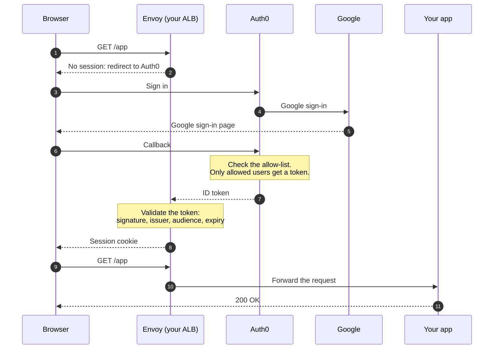

This page shows how to let only the people on your allow-list reach your app. Auth0 handles Google sign-in and checks each person's email against the list before it issues a token, so people who aren't allowed never reach Envoy. The configuration uses an [Envoy Gateway](https://gateway.envoyproxy.io/) `SecurityPolicy` and `datumctl`.

---

## How it works



**Authentication** (who are you): Auth0 handles Google social login.  
**Authorization** (are you allowed): Auth0 checks the user against your allow-list before issuing a token. Unauthorized users never get a token — [Envoy](/platform/envoy) never sees them.

---

## Prerequisites

- `datumctl` installed and authenticated
- A valid Datum **Project**
- An existing **HTTPProxy** in the Datum UI (this provides the Gateway and HTTPRoute automatically)
- An **Auth0 account** (free tier is sufficient)
- A **Google Cloud** project for the social connection

> **Note:** The HTTPProxy name is the name of the auto-generated HTTPRoute that the SecurityPolicy will target. Find it with:
> ```bash
> datumctl get httproute --project <project-id> --namespace default
> ```

---

## Part 1: Auth0 setup

### Step 1: Create an Auth0 tenant

1. Sign up at [auth0.com](https://auth0.com) and create a tenant
2. Note your **tenant domain** — it looks like `dev-xxxxxxxx.us.auth0.com`

---

### Step 2: Create an application

1. In the Auth0 dashboard go to **Applications** → **Applications** → **Create Application**
2. Name it (e.g. `datum-gateway-app`)
3. Select **Regular Web Applications**
4. Select **Create**
5. On the **Settings** tab, note your **Client ID** and **Client Secret**
6. Under **Allowed Callback URLs** add:
   ```
   https://<your-app-hostname>/oauth2/callback
   ```
7. Under **Allowed Logout URLs** add:
   ```
   https://<your-app-hostname>
   ```
8. Select **Save Changes**

---

### Step 3: Enable Google social login

1. Go to **Authentication** → **Social** → **Create Connection**
2. Select **Google / Gmail**
3. Enter your **Google OAuth Client ID** and **Client Secret**
   (from [Google Cloud Console](https://console.cloud.google.com) → APIs & Services → Credentials)
4. Enable the connection for your application under the **Applications** tab of the connection
5. In **Google Cloud Console**, add Auth0's callback URL to your OAuth client's **Authorized redirect URIs**:
   ```
   https://<your-auth0-domain>/login/callback
   ```
   This is required so Google can redirect back to Auth0 after login. Without it, Google returns `Error 400: redirect_uri_mismatch`.

> **Note:** If you do not have Google OAuth credentials yet, Auth0 provides a built-in dev key for testing. Go to the Google connection settings and leave Client ID/Secret blank — Auth0 will use its own dev credentials. Create dedicated Google OAuth credentials before moving to production.

---

### Step 4: Create an access control action

This is where individual user access is enforced. Auth0 runs this code during login — users not in the list are denied before a token is ever issued.

1. Go to **Actions** → **Library** → **Build Custom**
2. Name it `enforce-email-allowlist`
3. Select **Login / Post Login** trigger
4. Replace the default code with:

```javascript
exports.onExecutePostLogin = async (event, api) => {
  const allowedEmails = [
    "alice@example.com",
    "bob@datum.net",
  ];

  if (!allowedEmails.includes(event.user.email)) {
    api.access.deny("Access denied: you are not authorized to use this application.");
  }
};
```

5. Select **Deploy**
6. Go to **Actions** → **Triggers** → **post-login**
7. Drag your `enforce-email-allowlist` action from the right sidebar into the flow between **Start** and **Complete**
8. Select **Apply**

To add or remove a user: edit the `allowedEmails` array and select **Deploy**. No gateway config changes required.

---

## Part 2: Datum gateway configuration

The Datum HTTPProxy already manages the Gateway and HTTPRoute. You only need to create a **Secret** (to store the Auth0 client secret) and a **SecurityPolicy** (to attach OIDC to the route).

### Step 1: Set variables

<Tabs>
  <Tab title="macOS / Linux">

  ```bash
  project="your-project-id"
  namespace="default"
  route="your-httpproxy-name"
  hostname="your-app.example.com"
  auth0Domain="dev-xxxxxxxx.us.auth0.com"
  clientID="your-auth0-client-id"
  clientSecret="your-auth0-client-secret"
  ```

  </Tab>
  <Tab title="Windows (PowerShell)">

  ```powershell
  $project      = "your-project-id"
  $namespace    = "default"
  $route        = "your-httpproxy-name"
  $hostname     = "your-app.example.com"
  $auth0Domain  = "dev-xxxxxxxx.us.auth0.com"
  $clientID     = "your-auth0-client-id"
  $clientSecret = "your-auth0-client-secret"
  ```

  </Tab>
</Tabs>

---

### Step 2: Create the Auth0 client secret

The Secret must include the `gateway-sync` label or the edge proxy will not receive it and all requests will return HTTP 500.

<Tabs>
  <Tab title="macOS / Linux">

  ```bash
  b64Secret=$(printf "%s" "$clientSecret" | base64)

  cat <<EOF | datumctl apply --project $project --namespace $namespace -f -
  apiVersion: v1
  kind: Secret
  metadata:
    name: ${route}-oidc-secret
    labels:
      networking.datumapis.com/gateway-sync: "true"
  type: Opaque
  data:
    client-secret: $b64Secret
  EOF
  ```

  </Tab>
  <Tab title="Windows (PowerShell)">

  ```powershell
  $b64Secret = [Convert]::ToBase64String(
    [Text.Encoding]::UTF8.GetBytes($clientSecret)
  )

  @"
  apiVersion: v1
  kind: Secret
  metadata:
    name: ${route}-oidc-secret
    labels:
      networking.datumapis.com/gateway-sync: "true"
  type: Opaque
  data:
    client-secret: $b64Secret
  "@ | datumctl apply --project $project --namespace $namespace -f -
  ```

  </Tab>
</Tabs>

---

### Step 3: Apply the SecurityPolicy

This attaches OIDC authentication to the existing HTTPProxy route.

> **Warning:** Use only the `oidc` block — do not add a `jwt` block, as it conflicts with the OIDC filter and causes HTTP 500.

<Tabs>
  <Tab title="macOS / Linux">

  ```bash
  cat <<EOF | datumctl apply --project $project --namespace $namespace -f -
  apiVersion: gateway.envoyproxy.io/v1alpha1
  kind: SecurityPolicy
  metadata:
    name: ${route}-oidc
  spec:
    targetRefs:
      - group: gateway.networking.k8s.io
        kind: HTTPRoute
        name: $route
    oidc:
      provider:
        issuer: "https://${auth0Domain}"
      clientID: "$clientID"
      clientSecret:
        name: ${route}-oidc-secret
      redirectURL: "https://${hostname}/oauth2/callback"
      scopes:
        - openid
        - email
        - profile
  EOF
  ```

  Allow 60 seconds for the policy to propagate to the edge before testing.

  </Tab>
  <Tab title="Windows (PowerShell)">

  ```powershell
  @"
  apiVersion: gateway.envoyproxy.io/v1alpha1
  kind: SecurityPolicy
  metadata:
    name: ${route}-oidc
  spec:
    targetRefs:
      - group: gateway.networking.k8s.io
        kind: HTTPRoute
        name: $route
    oidc:
      provider:
        issuer: "https://${auth0Domain}"
      clientID: "$clientID"
      clientSecret:
        name: ${route}-oidc-secret
      redirectURL: "https://${hostname}/oauth2/callback"
      scopes:
        - openid
        - email
        - profile
  "@ | datumctl apply --project $project --namespace $namespace -f -
  ```

  </Tab>
</Tabs>

---

## Verification

### Unauthenticated request — redirects to Auth0

```bash
curl -I https://your-app.example.com
```

Expected:

```
HTTP/1.1 302 Found
Location: https://dev-xxxxxxxx.us.auth0.com/authorize?...
```

### Browser flow — allowed user

1. Open `https://your-app.example.com` in a browser
2. You are redirected to Auth0 → Google login
3. Sign in with an email in the allow-list
4. You are redirected back and the app loads — `HTTP 200`

### Browser flow — denied user

1. Sign in with an email **not** in the allow-list
2. Auth0 displays: `Access denied: you are not authorized to use this application.`
3. No token is issued — Envoy is never reached

---

## Managing access

All access control is managed in the Auth0 dashboard — no gateway config changes needed.

**Add a user:**
1. Go to **Actions** → **Library** → `enforce-email-allowlist`
2. Add the email to `allowedEmails`
3. Select **Deploy**

**Remove a user:**
1. Remove the email from `allowedEmails`
2. Select **Deploy**
3. Optionally revoke any active sessions: **User Management** → find user → **Invalidate Sessions**

---

## Cleanup

<Tabs>
  <Tab title="macOS / Linux">

  ```bash
  datumctl delete securitypolicy ${route}-oidc \
    --project $project --namespace $namespace --ignore-not-found

  datumctl delete secret ${route}-oidc-secret \
    --project $project --namespace $namespace --ignore-not-found
  ```

  </Tab>
  <Tab title="Windows (PowerShell)">

  ```powershell
  datumctl delete securitypolicy ${route}-oidc `
    --project $project --namespace $namespace --ignore-not-found

  datumctl delete secret ${route}-oidc-secret `
    --project $project --namespace $namespace --ignore-not-found
  ```

  </Tab>
</Tabs>

---

## Troubleshooting

| Symptom | Root cause | Resolution |
|---------|------------|------------|
| HTTP 200 instead of redirect | SecurityPolicy not yet propagated | Wait 60 seconds; verify with `datumctl get securitypolicy` |
| HTTP 500 on all requests (immediate) | `jwt` block present in SecurityPolicy | Remove `jwt` block — use `oidc` block only |
| HTTP 500 on all requests (immediate) | WAF (`TrafficProtectionPolicy`) blocking OIDC | Remove the `TrafficProtectionPolicy` targeting the Gateway |
| HTTP 500 on all requests | Secret missing `gateway-sync` label | Verify label is present; re-apply Secret if needed |
| Auth0 error: `callback URL mismatch` | App hostname not in Auth0 Allowed Callback URLs | Add `https://<hostname>/oauth2/callback` in Auth0 Application Settings |
| Google error 400: `redirect_uri_mismatch` | Auth0 callback not in Google OAuth client | Add `https://<auth0Domain>/login/callback` to Google Cloud Console Authorized redirect URIs |
| Redirect loop | `redirectURL` mismatch | Ensure it matches **Allowed Callback URLs** in Auth0 exactly |
| User sees "Access denied" at Auth0 | Not in allow-list | Add email to the Action and redeploy |
| User bypasses allow-list | Action not in Login flow | Verify action is added under **Actions** → **Triggers** → **post-login** |

### Useful debug commands

```bash
datumctl get securitypolicy --project $project --namespace $namespace
datumctl get secret --project $project --namespace $namespace
datumctl get httproute --project $project --namespace $namespace
datumctl get trafficprotectionpolicy --project $project --namespace $namespace
```

---

## Summary

| Concern | Where it lives |
|---------|----------------|
| Google social login | Auth0 social connection |
| Who is allowed | Auth0 Action (`enforce-email-allowlist`) |
| Token issuance | Auth0 — denied users never get a token |
| Token validation | Envoy OIDC block (handled automatically) |
| Session management | Envoy OIDC block (cookie) |
| App changes required | None |
