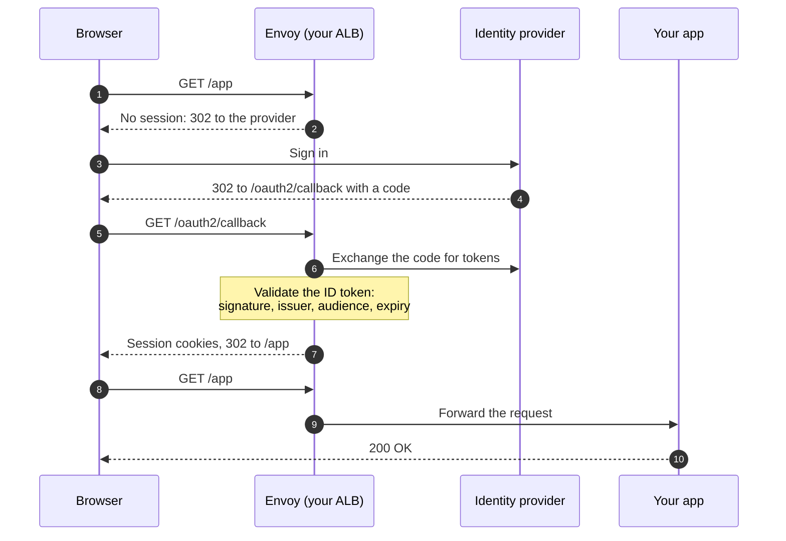

OIDC sign-in sends people without a session to your identity provider, then lets them through once they sign in. [Envoy](/platform/envoy) runs the whole OAuth 2.0 flow at the edge and keeps the session in an encrypted cookie, so your app needs no changes.

Any provider that follows [OpenID Connect](https://openid.net/connect/) works, including Okta, Microsoft Entra ID, Keycloak, Authentik, Dex, Google, and Auth0. The Datum side is the same for all of them. Only the issuer URL and the client you register change. For provider-specific steps, see [Google](/alb/authentication/oidc-google) and [Auth0](/alb/authentication/oidc-auth0).

## How it works



Envoy fetches the provider's settings from `ISSUER/.well-known/openid-configuration`, so it has to reach the issuer over the public internet.

## Before you start

- **A stable hostname.** The redirect URL is registered with your provider and must match exactly. Use a [custom hostname](/alb/operations/custom-domains) rather than the generated `*.datumproxy.net` name, so you don't have to re-register it if the load balancer changes.
- **An identity provider reachable from the internet over HTTPS**, with its discovery document at `ISSUER/.well-known/openid-configuration`.

## Step 1: Register a client with your provider

In your provider, create a **confidential** web application client (sometimes called a regular web application) that uses the authorization code flow, and:

1. Add the redirect URL `https://HOSTNAME/oauth2/callback`.
2. Note the **issuer URL**, the **client ID**, and the **client secret**.

| Provider | Issuer URL |
| --- | --- |
| Google | `https://accounts.google.com` |
| Auth0 | `https://YOUR_TENANT.auth0.com` |
| Okta | `https://YOUR_DOMAIN.okta.com/oauth2/default`, or your custom authorization server |
| Microsoft Entra ID | `https://login.microsoftonline.com/TENANT_ID/v2.0` |
| Keycloak | `https://KEYCLOAK_HOST/realms/REALM` |

Use the issuer exactly as the provider's discovery document lists it. When a `jwt` block checks tokens from the same provider, its `issuer` must match the tokens' `iss` claim character for character, including any trailing slash.

## Step 2: Store the client secret

The Secret must use the key `client-secret` and carry the `gateway-sync` label. Save this as `oidc-secret.yaml`:

```yaml
apiVersion: v1
kind: Secret
metadata:
  name: ALB_NAME-oidc
  labels:
    networking.datumapis.com/gateway-sync: "true"
type: Opaque
stringData:
  client-secret: YOUR_CLIENT_SECRET
```

```bash
datumctl apply -f oidc-secret.yaml
```

Keep the file out of Git, or generate it in CI from your secret manager.

## Step 3: Apply the SecurityPolicy

Save this as `oidc.yaml`, with your own issuer, client ID, and hostname:

```yaml
apiVersion: gateway.envoyproxy.io/v1alpha1
kind: SecurityPolicy
metadata:
  name: ALB_NAME-oidc
spec:
  targetRefs:
    - group: gateway.networking.k8s.io
      kind: HTTPRoute
      name: ALB_NAME
  oidc:
    provider:
      issuer: https://idp.example.com/realms/corp
    clientID: alb-app
    clientSecret:
      name: ALB_NAME-oidc
    redirectURL: https://app.example.com/oauth2/callback
    logoutPath: /logout
    scopes:
      - openid
      - email
      - profile
    forwardAccessToken: true
```

```bash
datumctl apply -f oidc.yaml
```

Make sure your provider is up before you apply the policy. If Envoy can't load the discovery document when the policy arrives, every request returns `500` until you delete and reapply the policy.

| Field | What it does |
| --- | --- |
| `provider.issuer` | Your provider's issuer URL |
| `clientID`, `clientSecret` | The client from Step 1. `clientSecret` names the Secret from Step 2. |
| `redirectURL` | Where the provider sends people back. Must match the URL registered in Step 1. Defaults to `/oauth2/callback` on the requested host. |
| `logoutPath` | A path that clears the session cookies and redirects to `/`, such as `/logout` |
| `scopes` | Scopes to request. `openid` is always added. Add `email` and `profile` to get those claims. |
| `forwardAccessToken` | Sends the provider's access token to your origin as `Authorization: Bearer` |
| `refreshToken` | Uses the refresh token to renew the session when the access token expires, instead of sending the person to sign in again |
| `cookieNames.idToken` | Fixes the ID token cookie's name, so a `jwt` block can read it. See [Restrict who can sign in](#restrict-who-can-sign-in). |
| `passThroughAuthHeader` | Lets requests that already carry a valid `Authorization: Bearer` token skip the sign-in redirect, so scripts and services can call the same hostname as people. Needs a `jwt` block that accepts those tokens. A request with an invalid token gets `401`, not a redirect. |
| `denyRedirect` | Returns `401` instead of a redirect for requests without a session that match given headers, such as `Accept: application/json` from a single-page app's API calls |

Field names follow [Envoy Gateway's OIDC reference](https://gateway.envoyproxy.io/docs/api/extension_types/#oidc).

## Step 4: Check it

```bash
curl -s -o /dev/null -w '%{http_code} %{redirect_url}\n' https://app.example.com/
```

An anonymous request returns `302` to your provider's sign-in page. Open the URL in a browser, sign in, and you land on your app.

## Restrict who can sign in

The `oidc` block alone lets in **anyone your provider will sign in**. With Google, that's anyone with a Google account. To decide who is allowed in at the load balancer, add a `jwt` block that reads the ID token from its cookie, and an `authorization` rule on its claims, in the same policy:

```yaml
spec:
  oidc:
    # ...as above, plus a fixed name for the ID token cookie:
    cookieNames:
      idToken: id-token
  jwt:
    providers:
      - name: idp
        issuer: https://idp.example.com/realms/corp
        audiences: ["alb-app"]                  # your client ID
        remoteJWKS:
          uri: https://idp.example.com/realms/corp/protocol/openid-connect/certs
        extractFrom:
          cookies: ["id-token"]
        claimToHeaders:
          - claim: email
            header: X-User-Email
  authorization:
    defaultAction: Deny
    rules:
      - name: allowed-people
        action: Allow
        principal:
          jwt:
            provider: idp
            claims:
              - name: email
                values: ["alice@example.com", "bob@example.com"]
```

Find `remoteJWKS.uri` as `jwks_uri` in your provider's discovery document. People who sign in but don't match a rule get `403`. You can allow by email, by group or role, or by a Google Workspace domain. See [Authorization rules](/alb/authentication/authorization) for what a rule can match.

## Sessions and signing out

- **The session lasts as long as the provider's tokens.** When the access token expires, Envoy refreshes it if `refreshToken` is on, or sends the person to sign in again.
- **Disabling someone at the provider ends their session** at the next refresh or sign-in, so within one access-token lifetime. Short access-token lifetimes, such as 5 to 15 minutes, make removal faster.
- **Signing out** with `logoutPath` clears the cookies at the load balancer. It doesn't sign the person out of the provider, so they may sign straight back in.

## Several sign-in policies on one hostname

If two routes on the same hostname each have their own OIDC policy, give each a **different** `redirectURL` path, such as `/oauth2/callback` and `/admin/oauth2/callback`, and register both with your provider. If they share a callback path, the callback can land on the other route's policy and fail with `401 OAuth flow failed`.

## Running your own identity provider

You can run an identity provider such as Keycloak yourself. Two things to know:

- **Host it outside Datum for now.** When the issuer is itself served through a Datum load balancer, some token exchanges from the edge fail, and sign-in returns `401 OAuth flow failed` after about 10 seconds. An issuer hosted elsewhere doesn't have this problem.
- **Behind a reverse proxy**, make the provider use the public hostname in its URLs. For Keycloak, set `KC_HOSTNAME` to the public URL and `KC_PROXY_HEADERS=xforwarded`. If the `issuer` in its discovery document doesn't match the policy, sign-in fails.

## Troubleshooting

| Symptom | Likely cause | Fix |
| --- | --- | --- |
| `500` on every request | The Secret is missing the `gateway-sync` label, or the provider was unreachable when the policy arrived. | Fix the label. Check the discovery URL, then delete and reapply the policy. |
| `redirect_uri_mismatch` or a similar provider error | The redirect URL isn't registered with the provider. | Register `redirectURL` exactly. |
| A redirect loop after signing in | `redirectURL` points at a different hostname than the one the person used. | Use one hostname, and set `redirectURL` to it. |
| `401 OAuth flow failed` after signing in | The code exchange failed: a wrong client secret, a callback shared with another policy, or an issuer served through a Datum load balancer. | Check the secret, give each policy its own callback path, or host the issuer outside Datum. |
| `403` after signing in | An authorization rule doesn't match, or the claim it checks isn't in the ID token. | Decode the ID token and compare its claims with the rule. Request the scopes that add the claim. |
| `200` without signing in | The policy isn't attached, or another policy already targets the route. | Check `targetRefs`, and run `datumctl describe securitypolicy` to look for `Conflicted`. |
