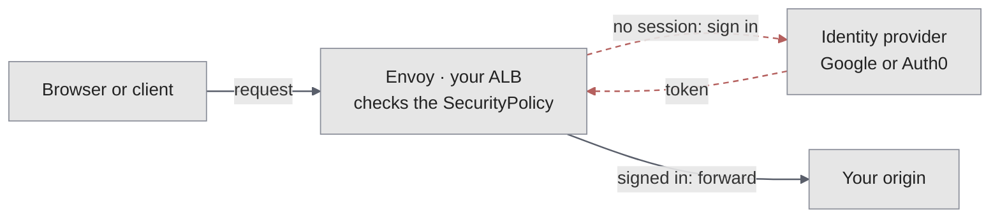

A load balancer can require people to prove who they are before a request ever reaches your origin. [Envoy](/platform/envoy) checks every request at the edge, in every Datum location, so your app doesn't need to change and unauthenticated traffic never reaches it.

## Choose a method

| Method | Who can get in | Best for | Guide |
| --- | --- | --- | --- |
| Basic authentication | Anyone with a username and password you set | Staging sites, internal tools, and quick protection for anything | [Basic authentication](/alb/authentication/basic-auth) |
| Sign in with Google (OIDC) | Anyone who signs in with a Google account | Requiring a real identity, such as for a team that uses Google Workspace | [Sign in with Google](/alb/authentication/oidc-google) |
| Per-user access with Auth0 | Only the people on your allow-list | Controlling exactly which people get in, by email address | [Per-user access with Auth0](/alb/authentication/oidc-auth0) |

The quickest way to start is basic authentication with `datumctl alb`:

```bash
printf '%s' "$password" | datumctl alb auth set ALB_NAME --user admin --password-stdin
```

## How it works

Authentication is configured with an [Envoy Gateway](https://gateway.envoyproxy.io/) `SecurityPolicy`. The policy names what it protects, such as a load balancer's route, and how people sign in. Datum sends the policy to Envoy in every location, and Envoy enforces it on every request:



- **Basic authentication** checks a username and password against an `htpasswd` list stored in a Secret. A request without valid credentials gets `401 Unauthorized`.
- **OIDC** redirects people without a session to an identity provider, such as Google or Auth0. Envoy validates the token the provider returns, then sets a session cookie so later requests go straight through.

Authentication runs alongside the [web application firewall](/alb/configuration/waf). A request has to pass both before it reaches your origin.

## Secrets must be labeled to reach the edge

Each method stores a credential in a Secret: an `htpasswd` list for basic authentication, or a client secret for OIDC. Datum doesn't send Secrets to the edge unless you ask it to, so that unrelated Secrets in your project are never copied. To make a Secret available to your load balancer, give it this label:

```yaml
metadata:
  labels:
    networking.datumapis.com/gateway-sync: "true"
```

<Warning>
  Without this label, Envoy receives the policy but not the Secret, and every request to the load balancer returns `500` instead of asking people to sign in. `datumctl alb auth set` adds the label for you.
</Warning>

## Check authentication

To see whether a load balancer has basic authentication, run `datumctl alb describe ALB_NAME`. To see every `SecurityPolicy` in your project, run `datumctl get securitypolicies`.

To confirm that a protected load balancer rejects anonymous requests, request it without credentials:

```bash
curl -s -o /dev/null -w '%{http_code}\n' https://HOSTNAME/
```

Basic authentication returns `401`. OIDC returns `302`, a redirect to the sign-in page.

| Symptom | Likely cause | Fix |
| --- | --- | --- |
| Every request returns `500` | The Secret isn't labeled to reach the edge, or its name is wrong. | Add the `gateway-sync` label, and check the Secret name in the policy. |
| Requests reach the origin without signing in | The policy targets a different route or load balancer. | Check `targetRefs` in the policy. |
| A redirect loop after signing in | The redirect URL doesn't match the one registered with the provider. | Make the two match exactly. |

For more, see the troubleshooting section of each guide.
