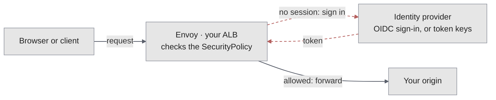

A load balancer can check who is calling before a request ever reaches your origin. [Envoy](/platform/envoy) checks every request at the edge, in every Datum location, so your app doesn't need to change and unauthenticated traffic never reaches it.

## Choose a method

| Method | Who it identifies | Best for | Guide |
| --- | --- | --- | --- |
| Basic Auth | A username from a list you keep | Staging sites, internal tools, and quick protection for anything | [Basic Auth](/alb/authentication/basic-auth) |
| API keys | A named client, such as `ci-pipeline` or `partner-acme` | Scripts, CI jobs, partners, and other machine clients | [API keys](/alb/authentication/api-keys) |
| JWT | Any user or service your token issuer signs for | APIs called with a bearer token from your own identity provider | [JWT](/alb/authentication/jwt) |
| Sign-in with OIDC | A person who signs in with your identity provider in a browser | Web apps and internal tools used by people | [Sign in with OIDC](/alb/authentication/oidc) |

OIDC works with any OpenID Connect provider, such as Google, Auth0, Okta, Microsoft Entra ID, or Keycloak. There are step-by-step guides for [Google](/alb/authentication/oidc-google) and [Auth0](/alb/authentication/oidc-auth0).

On top of any method, you can decide **who is allowed in**, with [authorization rules](/alb/authentication/authorization) on token claims (such as an email address, a Google Workspace domain, or a role), request headers, HTTP methods, or client IP ranges. A browser app on another origin can call your API once you allow it with [CORS](/alb/authentication/cors).

The quickest way to start is Basic Auth with `datumctl alb`:

```bash
printf '%s' "$password" | datumctl alb auth set ALB_NAME --user admin --password-stdin
```

Basic Auth is the only method `datumctl alb` sets up. Every other method is a `SecurityPolicy` manifest that you apply with `datumctl apply`.

## How it works

Authentication is configured with an [Envoy Gateway](https://gateway.envoyproxy.io/) `SecurityPolicy`. The policy names what it protects, a load balancer's route, and how callers prove who they are. Datum sends the policy to Envoy in every location, and Envoy enforces it on every request:



- **Basic Auth** checks a username and password against an `htpasswd` list stored in a Secret.
- **API keys** checks a key in a header, query parameter, or cookie against keys stored in a Secret. The key's name in the Secret identifies the client.
- **JWT** checks the signature, issuer, audience, and expiry of a bearer token against your issuer's public keys. Datum never sees your users.
- **OIDC** redirects people without a session to your identity provider. Envoy validates the token the provider returns, then sets a session cookie so later requests go straight through.

### Where a SecurityPolicy attaches

When you create a load balancer, Datum creates a Gateway and an `HTTPRoute` with the same name as the load balancer. A `SecurityPolicy` targets that route:

```yaml
spec:
  targetRefs:
    - group: gateway.networking.k8s.io
      kind: HTTPRoute
      name: ALB_NAME
```

A route takes **one** `SecurityPolicy`. To combine methods, such as OIDC sign-in with a claim rule and CORS, put them all in the same policy. A second policy on the same route is rejected with the condition `Conflicted`, and the first one stays in force.

A policy can also target the load balancer's Gateway, which also has the load balancer's name. `datumctl alb auth set` does this. A Gateway policy covers every route that has no policy of its own. A route's own policy **replaces** the Gateway's policy for that route. The two aren't merged.

<Warning>
  If you protect a load balancer with `datumctl alb auth set` and then add any route-level policy, even one with only CORS, Basic Auth stops applying to that route. `datumctl alb describe` still shows Basic Auth as enabled. Put `basicAuth` in the route's policy instead. See [Basic Auth](/alb/authentication/basic-auth).
</Warning>

The policy covers every path on the route. To protect paths differently, such as `/api` with API keys and the rest with OIDC, add a route for that path and give it its own policy. See [Different authentication per path](/alb/authentication/per-path).

### What the origin receives

Once a request is allowed, Envoy can pass the caller's identity to your origin in a header, so your app knows who is calling without checking credentials itself:

| Method | Identity at the origin |
| --- | --- |
| Basic Auth | The username in a header you name (`forwardUsernameHeader`). The `Authorization` header, with the password, is also forwarded. |
| API keys | The client's name in a header you name (`forwardClientIDHeader`). Set `sanitize: true` to strip the key itself. |
| JWT | Any claims you choose, each in its own header (`claimToHeaders`), plus the original `Authorization` header |
| OIDC | The provider's access token as `Authorization: Bearer` (`forwardAccessToken: true`), and claims from the ID token with a `jwt` block |

Envoy sets these headers itself and overwrites any value the client sent, so a client can't spoof them.

### Order of checks

The [web application firewall](/alb/configuration/waf) runs first. A request it blocks gets `403` before authentication runs. A request then has to pass authentication and any authorization rules before it reaches your origin.

| Response | Meaning |
| --- | --- |
| `302` | No OIDC session. The browser is sent to sign in. |
| `401` | Missing or invalid credentials: no password, a wrong key, or an expired or forged token |
| `403` | Valid credentials that aren't allowed in, because of an authorization rule or a token for a different audience. Also returned by the firewall. |
| `500` | The policy can't load what it needs, such as an unlabeled Secret or an identity provider that was unreachable when the policy was applied |

## Secrets must be labeled to reach the edge

Basic Auth, API keys, and OIDC each store a credential in a Secret: an `htpasswd` list, a set of keys, or an OIDC client secret. Datum doesn't send Secrets to the edge unless you ask it to, so that unrelated Secrets in your project are never copied. To make a Secret available to your load balancer, give it this label:

```yaml
metadata:
  labels:
    networking.datumapis.com/gateway-sync: "true"
```

<Warning>
  Without this label, Envoy receives the policy but not the Secret, and every request to the load balancer returns `500` instead of asking for credentials. `datumctl alb auth set` adds the label for you.
</Warning>

JWT doesn't need a Secret: Envoy fetches your issuer's public keys, or reads them from the policy.

## Check authentication

`datumctl alb describe ALB_NAME` shows only Basic Auth set up by `datumctl alb auth`, and keeps showing it even when a route-level policy has replaced it. It doesn't show a `SecurityPolicy` you applied yourself, or routes you added. To see every policy in your project and whether it was accepted, run:

```bash
datumctl get securitypolicies
datumctl describe securitypolicy POLICY_NAME
```

`Accepted=False` with the reason `Conflicted` means another policy already targets the same route.

To confirm that a protected load balancer rejects anonymous requests, request it without credentials:

```bash
curl -s -o /dev/null -w '%{http_code}\n' https://HOSTNAME/
```

Basic Auth, API keys, and JWT return `401`. OIDC returns `302`, a redirect to the sign-in page.

Authentication outcomes show up in [access logs](/alb/observability) only as response codes. There are no metrics or log fields for who signed in, which key was used, or why a token was rejected.

| Symptom | Likely cause | Fix |
| --- | --- | --- |
| Every request returns `500` | The Secret isn't labeled to reach the edge, or its name is wrong. | Add the `gateway-sync` label, and check the Secret name in the policy. |
| Every request returns `500` with OIDC | The identity provider was unreachable when the policy was applied. | Make sure the provider's discovery URL answers, then delete and reapply the policy. |
| Requests reach the origin without credentials | The policy targets a different route, it was rejected as `Conflicted`, or a route-level policy replaced Basic Auth from `alb auth set`. | Check `targetRefs`, and run `datumctl describe securitypolicy`. Put every setting for a route in one policy. |
| A redirect loop after signing in | The redirect URL doesn't match the one registered with the provider. | Make the two match exactly. |
| A valid token gets `403` | An authorization rule doesn't match, or the token's audience isn't in `audiences`. | Decode the token and compare its claims with the policy. |

For more, see the troubleshooting section of each guide.

## What isn't available

- **Client certificates (mutual TLS).** A load balancer can't ask clients for a certificate. `ClientTrafficPolicy` isn't available, and the Gateway's TLS settings can't be changed.
- **Your own authorization service (`extAuth`).** A policy can't call out to an external service to decide on each request. The API rejects it with `extAuth is not permitted`.
- **Retries to the identity provider.** If your issuer is briefly unreachable, Envoy doesn't retry. The API rejects retry settings.
- **Location-based rules.** Authorization rules can match client IP ranges but not countries.
- **Datum platform credentials.** The tokens that `datumctl` and [service accounts](/projects/service-accounts) use to call the Datum API are for the platform, not for your apps. Use your own identity provider to protect your workloads.
