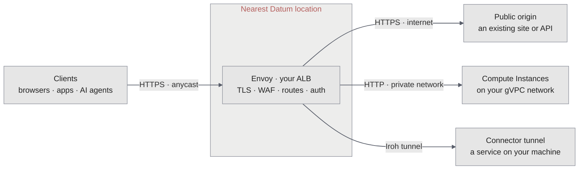

<Note>
**Working with this resource via an AI agent?** Datum publishes three skills covering Application Load Balancer: [Application Load Balancer](/agents/skills/alb) (creating and managing one, plus WAF and auth), [Client Traffic](/agents/skills/client-traffic) (TLS termination, HTTP/3, connection limits), and [HTTPRoute](/agents/skills/httproute) (path routing, traffic splitting, redirects).
</Note>

Datum's Application Load Balancer (ALB) is an edge proxy built on [Envoy](/platform/envoy), with a [Coraza](https://www.coraza.io/)-based [web application firewall](/alb/configuration/waf) (WAF). It started life as Datum's "AI Gateway", and it's built for AI and agent traffic as much as for websites and APIs.

Application Load Balancers help you protect and route internet traffic to your backend services. We support HTTP(S) 1.1, HTTP/2, gRPC, and WebSockets.

<Tip>
  Running NGINX, Apache, Caddy, or Traefik in front of your app? To replace that container with an ALB, see [Use ALB as your HTTP proxy](/guides/alb-as-httpd).
</Tip>

<Frame caption="The overview for a load balancer: whether it is serving, live request rate, error rate, latency and blocked requests, and the hostnames it answers on">
  
</Frame>

## How it works

An ALB isn't a server you size or place. You declare it once in your project, and Datum serves it from Envoy in every Datum location:



- **Clients reach the nearest location.** Your ALB's hostnames are anycast, so each request arrives at the nearest Datum location. Envoy there terminates TLS, runs the firewall, and applies your routes.
- **Datum runs and scales the proxies.** Envoy runs as a shared fleet in every location, serving every customer's ALBs. Creating an ALB doesn't start new infrastructure, and you don't choose locations or capacity.
- **Changes reach every location.** When you change an ALB, Datum publishes the new configuration to Envoy in every location.
- **Your origin can be anywhere.** An origin can be a public site, reached over HTTPS on the internet; [Compute Instances](/compute/compute-and-alb), reached over plain HTTP on your private [gVPC](/galactic-vpc/overview) network; or a service on your own machine, reached through a [Connector tunnel](/connectors/tunnels).

For Compute origins, Envoy prefers an Instance in the same location, and sends the request to the nearest location with a healthy Instance when there isn't one. For how Datum runs Envoy, including how it reaches your private network without ever reaching another customer's, see [Envoy](/platform/envoy).

## What an ALB is made of

In Datum today, an Application Load Balancer is a product experience over several platform resources — not a single API kind. Creating an ALB in the [Cloud Portal](https://cloud.datum.net) stitches these together for you:

```text
Application Load Balancer (product)
├── HTTPProxy (user-created) — L7 routing, origin, Force HTTPS, Host header
│     └── operator materializes Gateway (same name), canonical hostname,
│         DNSRecordSet(s), and TLS certificates (ACME)
├── TrafficProtectionPolicy (created with the proxy, same name) — Coraza/OWASP WAF
│     └── targetRefs → Gateway
└── [optional] SecurityPolicy + Secret *-basic-auth — basic authentication
```

| Piece | Role |
|-------|------|
| **`HTTPProxy`** | Primary user-facing resource for hostnames, origin backends, redirects, and request filters |
| **`TrafficProtectionPolicy`** | WAF policy (Observe / Enforce / Disabled) attached 1:1 to the proxy's Gateway |
| **Gateway** (operator) | Provisioned from the HTTPProxy; WAF and auth policies target it |
| **DNS + TLS** (operator) | Canonical hostname, DNSRecordSets, and ACME certificates from proxy status |
| **SecurityPolicy** (optional) | Basic auth via [Envoy Gateway](https://gateway.envoyproxy.io/), backed by a Secret |

Portal create always POSTs an `HTTPProxy`, then attempts a matching `TrafficProtectionPolicy` (best-effort today if WAF attach fails). There's no composite ALB API yet. With `datumctl`, `datumctl alb create` creates the `HTTPProxy` and its `TrafficProtectionPolicy` for you (see [Create a load balancer](/alb/operations/overview#create-a-load-balancer)), or you can apply the resources yourself.

To learn how Datum runs Envoy, see [Envoy](/platform/envoy). See [HTTPProxy](/alb/httpproxy/overview) for schemas and `datumctl` examples.

## Features

Each Application Load Balancer deploys with a default hostname and enforces HTTPS (you can disable this).

- **Protection** - The [**OWASP Coraza Web Application Firewall (WAF)**](https://www.coraza.io/) provides built-in protection with the [OWASP Core Rule Set](https://coreruleset.org/), running inside Envoy before requests reach your origin. A load balancer created with `datumctl alb create` starts in `Enforce` mode at sensitivity 1. A `TrafficProtectionPolicy` that doesn't set a mode runs in `Observe` mode. See [Roll out traffic protection safely](/alb/operations/traffic-protection).
- **Custom Hostnames** – Verify domains (or use already verified domain resources) to use custom hostnames with an Application Load Balancer.
- **Basic Authentication** - Add a username and password to restrict access to an Application Load Balancer.
- **Load Balancing** - Split traffic across several origins by weight, choose the load balancing algorithm, and turn on passive health checks. See [Load balancing and health checks](/alb/configuration/load-balancing).

To monitor the health of your Application Load Balancers, you can use:

- **Status** – View status “Accepted” and “Programmed”, Generated hostname(s), Custom hostname verification status, and TLS verification status.
- **Metrics** - The Datum Cloud portal provides a variety of baseline metrics, filtered by region, including: global upstream latency percentile, regional upstream RPS, and regional upstream response.
- **Activity Logs** - View and filter activity across a project, and filter by resource type (including Application Load Balancer) and action.
