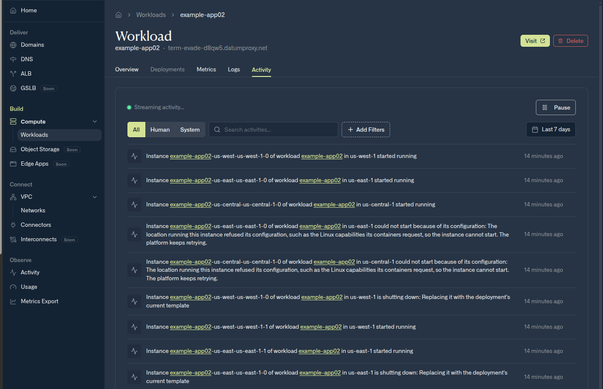

This page lists common Compute errors and states, what they mean, and how to fix them. To check on workloads and Instances first, see [Operations](/compute/operations).

<Note>
  Compute is in preview, and the `v1alpha` API can change.
</Note>

## IPv6 readiness

Compute and gVPC are IPv6 only. Instances have no IPv4 address, and the internet reaches them only through the ALB. Check these before you deploy your own app:

- **Listen on `::`.** An app bound to `0.0.0.0`, or to `listen 80;` in nginx, is unreachable. Bind the port that you pass to `--http-port` on `::`.
- **Connect by hostname.** Use a name, not an IPv4 address, for every service the app calls, including database URLs and proxy targets in its config. See [Reach the internet](/galactic-vpc/networks/traffic).
- **Serve plain HTTP.** Datum terminates TLS at the ALB and connects to your Instances over HTTP.

| Server | Listen on IPv6 |
| --- | --- |
| nginx | `listen [::]:80;` |
| Node.js | `app.listen(8080, "::")` |
| Python | `uvicorn app:app --host :: --port 8080` |
| Go | `http.ListenAndServe(":8080", handler)`, which listens on IPv6 and IPv4 |

To check the listen address on a machine with IPv6, run `ss -ltn` and look for `[::]:8080`. An IPv4-only app shows `0.0.0.0:8080` instead.

If you're an agent deploying an app for a user, search the code and config for `0.0.0.0`, `127.0.0.1`, `listen 80`, and IPv4 addresses, change them to `::` and hostnames, and then deploy with `--http-port`.

## Common problems

The following table lists common errors and states, what they mean, and how to fix them. Errors that Datum returns when you apply a workload appear in the command output. Reasons appear in `datumctl get workloads`, `datumctl get instances`, and `datumctl compute instances describe`.

| Error or reason | Meaning | What to do |
| --- | --- | --- |
| `must include a registry` | The image reference has no registry host. | Use a full reference, such as `docker.io/library/redis:7`. |
| `... are not supported by the "CLASS" runtime class` | The workload uses a feature that its runtime class doesn't offer, such as a `disk` volume on either class, or `envFrom` or added capabilities on `unikernel`. | Remove the feature, or deploy a new workload with a class that offers it. See [Choose a runtime class](/compute/runtimes/overview). |
| `resources: Forbidden: not implemented` | The workload sets CPU or memory for a container. | Remove `resources`, and set `runtime.resources.instanceType` to `datumcloud/d1-standard-2`. |
| `permission to use the network was denied` | You don't have permission to attach workloads to the network. | Ask a project administrator for the **Network Admin** role. |
| `permission to get ... was denied` | You can't read a ConfigMap or Secret that the workload references. | Ask for read access to the object, or reference another object. |
| `volume must be attached at least 1 time` | The workload declares a volume that no container mounts. | Add a `volumeAttachments` entry with a `mountPath`, or remove the volume. |
| `NetworkNotFound` | The network named in `networkInterfaces` doesn't exist. | Create the network. See [gVPC configuration](/galactic-vpc/configuration). |
| `RuntimeClassNotServed` | A location in the [placement](/compute/placement-and-scaling) doesn't serve the workload's runtime class. | Choose another location, or deploy a new workload with a class that the location serves. |
| `NoMatchingLocations` | A placement's selector matches no location. | Fix the selector, or list locations by name. |
| `QuotaExceeded` or `QuotaNotGranted` | Your project's compute quota is used up. | Run fewer Instances, delete unused workloads, or ask for more quota. See [Limits and quotas](/compute/limits-and-quotas). |
| `QuotaNoBudget`, or another reason that starts with `Quota` | Compute quota isn't set up correctly for your project. | Contact [support@datum.net](mailto:support@datum.net). Datum fixes this. |
| `ReferencedDataNotReady` with `SourceNotFound` | A referenced ConfigMap or Secret doesn't exist. | Create the object, or fix its name in the workload. |
| `ReferencedDataNotReady` with `SourceTooLarge` | A referenced ConfigMap or Secret is larger than 256 KiB, or all of them together exceed 1 MiB. | Make the objects smaller. |
| `ReferencedDataNotReady` with `SourceUnauthorized` | Datum can't read a referenced ConfigMap or Secret. | Check that the object is in the same project, and contact support if the problem continues. |
| `ImageUnavailable` | Datum couldn't pull the image. | Check the image reference and tag. For a private registry, check the `imagePullSecrets` Secret. |
| A standard container image, such as nginx, won't start | You didn't set a runtime class, so the workload uses the default `unikernel` class, which doesn't boot standard container images. | Deploy a new workload with `--runtime-class=general-purpose`. You can't change a workload's runtime class. See [Run a container image](/compute/runtimes/general-compute). |
| `InstanceCrashing` | The program starts and exits repeatedly. | Check the command, arguments, environment variables, and mounted files. For a `unikernel` workload, rebuild with `datumctl compute build --analyze`. |
| `ConfigurationError` | Datum refused the configuration before the program ran. | Check the environment variables and volume references. |
| The Instance stays `Starting` for more than a few minutes | The first image pull can take a while. A program that exits at startup can also stay in this state. | Check the image and configuration. For a `unikernel` workload, run `datumctl compute build --analyze`. If the problem continues, contact support. |
| The Instance is `Available`, but the ALB's hostname returns an error | The app isn't reachable on the published port, or the container isn't running even though the Instance is `Available`. | Make sure that the app listens on IPv6 (`::`; in nginx, add `listen [::]:8080;` because `listen 8080;` binds IPv4 only), serves plain HTTP, and uses the port that you passed to `--http-port`. Check the logs with `datumctl compute logs WORKLOAD_NAME`. If the container exits at startup, check its `securityContext`. See [Images that use sudo or setuid](/compute/runtimes/general-compute#images-that-use-sudo-or-setuid). For a walkthrough of what IPv6-only means for your app, see [How debugging a 503 turned into an IPv6 crash course](https://www.datum.net/blog/ipv6-crash-course). |
| The ALB returns `503` for a minute or two after the Instance becomes `Available` | The Instance is running, but the app inside it is still starting. | Wait, or give the app a faster startup. Apps such as JVMs can take a minute or more to listen. |
| `sudo` or another setuid program fails with a permission error | `allowPrivilegeEscalation` defaults to `false`. | Do the privileged work at build time, or set `allowPrivilegeEscalation: true`. See [Images that use sudo or setuid](/compute/runtimes/general-compute#images-that-use-sudo-or-setuid). |
| A new image version doesn't show up after a rollout | The image was pushed again under the same tag. | Push each version with a new tag, or reference the image by digest. |
| An Instance can't connect to an IPv4 address, such as `203.0.113.10` | Instances have IPv6 addresses only. They reach IPv4-only services through DNS64 and NAT64, which work only when the app connects by hostname. | Connect by hostname. If the service has a public IPv4 address but no name, create an `A` record for it in a public DNS zone you control. See [Reach the internet](/galactic-vpc/networks/traffic#reach-the-internet). |
| An Instance can't connect to an IPv4-only service by hostname | The app or image uses its own DNS resolver without DNS64, such as DNS over HTTPS or a hard-coded public resolver, which returns only IPv4 addresses. | Use the resolvers that Datum configures, in the Instance's `/etc/resolv.conf`. They perform DNS64. |
| A destination that allowlists source addresses rejects the Instance | Outbound traffic leaves from addresses that are shared with other Datum customers and can change. | Authenticate to the destination with credentials, such as an API key or a client certificate, instead of allowlisting addresses. |
| `curl` can't resolve the ALB's hostname | The new hostname hasn't propagated. | Wait a few minutes and try again. |

## See why an Instance won't start

When an Instance can't start, Datum records why. In the [Cloud Portal](https://cloud.datum.net), open the workload and select the **Activity** tab. Each Instance's start, stop, and failure appears with a plain-language reason. In this example, two Instances couldn't start because their location refused the Linux capabilities the containers requested, and the platform keeps retrying. The fix is in the workload's configuration, not in the Instance.

<Frame caption="A workload's Activity tab, showing Instances that couldn't start because of their configuration">
  
</Frame>

To see the same reason from a terminal, run `datumctl compute instances describe INSTANCE_NAME`, or list recent events with `datumctl activity events`.

To see a history of changes to your workloads, use `datumctl activity`. For more information, see [Querying activity](/datumctl/activity/overview).

If you can't resolve a problem, contact [support@datum.net](mailto:support@datum.net) with the workload name, the project ID, and the output of `datumctl compute instances describe INSTANCE_NAME`.

## Debug inside an Instance

To open an interactive shell or run a command in a running `general-purpose` Instance, see [Instance shell](/compute/instance-shell). A shell needs the Instance to be running and the image to include `sh`. If the container exits too quickly to open a shell (`InstanceNotRunning`), read its logs instead. To read Instance output and CPU and memory usage, see [Observability](/compute/observability).

## What's next

- To check quota and review limits, see [Limits and quotas](/compute/limits-and-quotas).
- To review what Compute doesn't support yet, see [Limitations and roadmap](/compute/limitations-and-roadmap).
