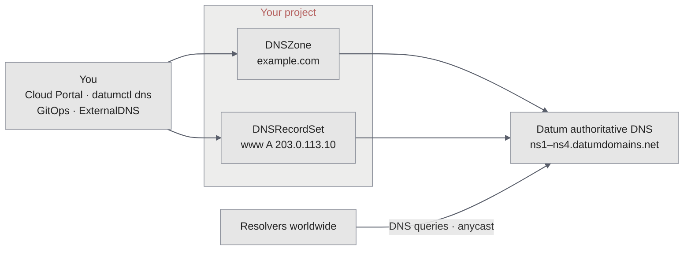

Datum treats domains and DNS zones as resources in your project. You can track
and verify domains, host public zones on Datum's global anycast network, and use
Private DNS to resolve resources inside your VPCs.

<CardGroup cols={2}>
  <Card title="Domains" icon="globe" href="/domain-dns/domains">
    Track domains wherever they are registered, and verify ownership to use them with other Datum services.
  </Card>
  <Card title="Authoritative DNS" icon="server" href="/domain-dns/dns">
    Host authoritative DNS for your zones on Datum's global anycast network.
  </Card>
  <Card title="Private DNS" icon="shield-halved" href="/domain-dns/private-dns">
    Resolve private resource and service names inside your VPCs.
  </Card>
</CardGroup>

## How it works

- **Zones and records are resources.** A `DNSZone` holds one domain, and each `DNSRecordSet` holds the records at a name in that zone. They live in your project, with the same access control and [activity logs](/operations/activity-logs) as everything else.
- **Datum serves them worldwide.** Datum programs your records into its authoritative DNS and publishes them to nameservers on its global anycast network. Each zone and record reports `Programmed` once Datum is serving it.
- **Your registrar points the internet at Datum.** Your domain resolves through Datum once your registrar lists Datum's nameservers.

## Ways to manage DNS

- **[Cloud Portal](https://cloud.datum.net)** for zones, records, and zone file import and export.
- **The [`datumctl dns` plugin](/domain-dns/operations)** for the terminal and scripts, including delegation checks, zone file import, and drift checks.
- **Manifests and [GitOps](/datumctl/gitops)**, to keep zones and records in Git. See [Manage DNS with manifests](/domain-dns/operations#manage-dns-with-manifests).
- **[ExternalDNS](/domain-dns/operations#automate-records-with-externaldns)**, to create records automatically for services in your own Kubernetes clusters.
- **AI agents**, with [Datum MCP](/agents/datum-mcp) or the [DNS skill](/agents/skills/dns).

Domains and DNS work together with the [Application Load Balancer](/alb/overview): a verified domain can serve traffic on a load balancer, and a Datum-hosted zone can point at it. See [Point a domain at a load balancer](/domain-dns/point-to-alb).

## Get started

<CardGroup cols={2}>
  <Card title="Move a zone to Datum" icon="right-left" href="/domain-dns/operations#move-a-zone-to-datum">
    Import your records, check DNSSEC, and point your domain at Datum.
  </Card>
  <Card title="Check that DNS is live" icon="heart-pulse" href="/domain-dns/observability">
    See whether records are serving and your domain is delegated.
  </Card>
</CardGroup>
