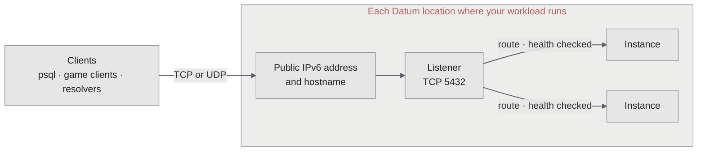

A Network Load Balancer (NLB) publishes a workload on a public TCP or UDP port. Use it for traffic that isn't HTTP, such as a Postgres database, a game server, a DNS server, or a service that terminates its own TLS. The NLB forwards each connection or UDP flow unchanged to a healthy Instance of your workload. It doesn't read, decrypt, or change the traffic.

For HTTP, HTTPS, gRPC, and WebSockets, use the [Application Load Balancer](/alb/overview) (ALB) instead.

<Note>
  NLBs are in early access, and the `networking.datumapis.com/v1alpha` API can change. Early access serves public IPv6 only, in three US locations. See [Limitations and roadmap](/nlb/limitations-and-roadmap).
</Note>

## NLB or ALB

| | NLB | ALB |
| --- | --- | --- |
| Traffic | Any TCP or UDP protocol | HTTP/1.1, HTTP/2, HTTP/3, gRPC, WebSockets |
| Ports | The port you choose on each listener, such as `5432` or `7777` | `80` and `443` |
| TLS | Passes through unchanged. Your workload keeps its certificate. | Ends at the load balancer, with certificates that Datum issues |
| Routing | One listener to one backend port | By hostname, path, and headers, across several origins |
| Protection | None. Your workload sees the raw traffic. | Web application firewall, authentication |
| Backends | [Compute](/compute/overview) workloads, through a [network service](/galactic-vpc/networks/network-services) | Compute workloads, public origins, and [Connector tunnels](/connectors/tunnels) |
| Addresses | A public IPv6 address and hostname in each location where your workload runs | Anycast hostnames served from every Datum location |
| Locations | `us-central-1`, `us-east-1`, and `us-west-1` in early access | Every Datum location |

If your service speaks HTTP, use an ALB, even when it isn't a website. The ALB adds TLS certificates, a firewall, and routing that an NLB doesn't have.

## How it works



- **An address in each location.** Datum gives the NLB a public IPv6 address and a generated hostname in each location where its backend workload has Instances. A client that connects to a location's address reaches an Instance in that location. Unlike the ALB, an NLB address isn't anycast, and traffic doesn't move to another location when a location has no healthy Instance. See [Addresses and hostnames](/nlb/addresses-and-hostnames).
- **Listeners accept traffic.** A listener accepts one protocol, TCP or UDP, on one public port.
- **Routes pick the backend.** A route connects a listener to a named port on a [network service](/galactic-vpc/networks/network-services), which selects your workload's Instances. The public port and the port your app listens on can differ. See [Listeners and routes](/nlb/listeners-and-routes).
- **Health checks decide which Instances get traffic.** Datum checks each Instance over TCP every 5 seconds, and sends new connections only to healthy ones. See [Health checks](/nlb/health-checks).
- **Each connection stays on one Instance.** Datum spreads connections and UDP flows across healthy Instances by hashing each one's addresses and ports, so packets of the same connection or flow keep reaching the same Instance. See [How the NLB handles traffic](/nlb/traffic-handling).

## What an NLB is made of

An NLB is two resources that you create, plus the network service that it sends traffic to:

```text
NetworkLoadBalancer         public addresses and listeners
└── NetworkLoadBalancerRoute   one listener → one network service port, with a health check
      └── NetworkService          selects your workload's Instances and names their ports
```

| Resource | What it holds |
| --- | --- |
| `NetworkLoadBalancer` | The [gVPC network](/galactic-vpc/networks/overview) the NLB serves, the public addresses it requests, and its listeners. Its status reports each location's addresses and hostname. |
| `NetworkLoadBalancerRoute` | Which listener it serves, which network service port it sends traffic to, and the health check. |
| `NetworkService` | Which Instances answer, and the name, number, and protocol of each port. See [Network services](/galactic-vpc/networks/network-services). |

The [Cloud Portal](https://cloud.datum.net) creates the NLB and its route together. From the command line, apply both from a manifest with `datumctl apply`. There's no `datumctl nlb` command yet.

## Get started

<CardGroup cols={2}>
  <Card title="Operations" icon="rocket" href="/nlb/operations">
    Prepare a backend, create an NLB, and connect to it.
  </Card>
  <Card title="Listeners and routes" icon="diagram-project" href="/nlb/listeners-and-routes">
    How listeners accept traffic, and how routes send it to your workload.
  </Card>
  <Card title="Health check a UDP service" icon="heart-pulse" href="/nlb/health-checks#health-check-a-udp-service">
    Publish a UDP port, with a TCP port for health checks.
  </Card>
  <Card title="Troubleshooting" icon="wrench" href="/nlb/troubleshooting">
    Work out why an NLB isn't serving.
  </Card>
</CardGroup>
