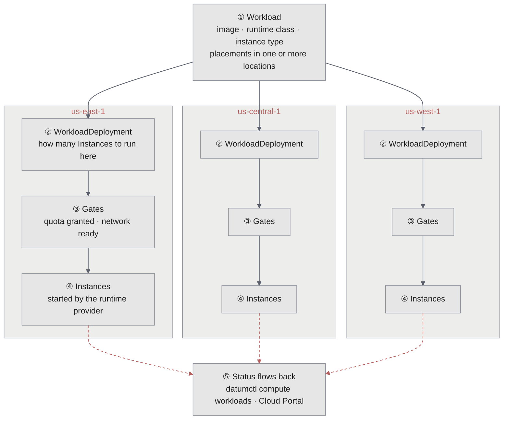
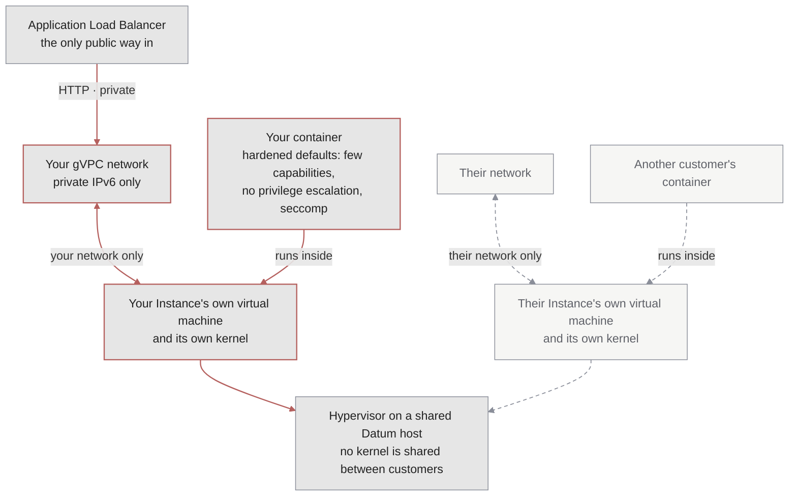

Isolation is the idea Datum builds everything else on: each customer's work is kept apart from every other customer's, at the virtual machine, the network, and the control plane, and Datum operates that separation for you. Compute is where you see it most. Every Compute Instance runs in its own virtual machine on your own [gVPC](/galactic-vpc/overview) network, and the platform places, starts, and watches it in every location.

This page explains the isolation and operating ideas underneath [Compute](/compute/overview): how a workload becomes running Instances, how each Instance is kept apart from every other customer's, and how that stays efficient. For how to use Compute, see the [Compute documentation](/compute/overview).

## From workload to Instances

You describe what to run in a *workload*: a container image, a runtime class, an instance type, and *placements* that say which locations to run in and how many Instances to keep in each. Datum turns it into running Instances in every location you named:

1. **You declare a workload** in your project's control plane, with `datumctl compute deploy`, a manifest, or the [Cloud Portal](https://cloud.datum.net).
2. **Datum splits it by location.** Each placement becomes a *WorkloadDeployment* in each of its locations, which tracks how many Instances that location should run.
3. **Each Instance waits at its gates.** An Instance doesn't start until your project's quota grants its resources and its private network is ready. An Instance that would go over quota waits, and reports why, rather than starting.
4. **A runtime provider starts the Instance.** Each location runs a provider for each runtime class. The provider starts the Instance in its own virtual machine and attaches it to your [gVPC](/galactic-vpc/overview) network.
5. **Status flows back.** Each location reports its Instances' health to your project. To see it, run `datumctl compute workloads describe WORKLOAD_NAME`.

Each location runs its own Instances, so a problem in one location doesn't stop Instances in the others.

## Isolation at the virtual machine

Many container platforms run every customer's containers on one shared Linux kernel, separated by kernel features. A single kernel bug can then cross from one customer to another. Datum doesn't do that. Every Instance, in every runtime class, gets its own virtual machine and its own kernel:

The only thing two customers' Instances share is the hypervisor underneath. Inside its virtual machine, an Instance can do things that would be risky on a shared kernel, such as running as root or adding Linux capabilities, because they only affect its own virtual machine.

## Runtime classes

A *runtime class* is a way of running an Instance. Each class is a published contract about its isolation, which images it runs, and how fast its Instances start. Datum offers two:

- **General purpose** runs any standard Linux container image, unchanged, inside a lightweight virtual machine built with [Kata Containers](https://katacontainers.io). Datum's [kata-provider](https://github.com/datum-labs/kata-provider) uses Cloud Hypervisor, which reserves far less memory for each virtual machine than QEMU, so more Instances fit on each host.
- **Unikernel** runs your app as a [unikernel](/compute/runtimes/unikernels): a single-purpose virtual machine that contains your app and only the operating system code it uses, built on [Unikraft](https://unikraft.org/).

Each class has its own provider, released and operated separately, so a fault in one class can't take down the other. To read the contracts, run `datumctl get runtimeclasses`, or `datumctl get runtimeclass CLASS_NAME -o yaml` for the full detail. To compare the classes, see [Choose a runtime class](/compute/runtimes/overview).

## Secure by default

Isolation is the foundation, and gVPC carries it to the network. On top of both, every Instance starts with defaults you don't have to remember to set:

- **Few privileges.** A `general-purpose` container starts with a short list of Linux capabilities, enough for common images such as nginx or Postgres to start, instead of the full set. It can't gain new privileges after it starts, and the runtime's default seccomp profile filters its system calls. A container that needs more asks for it explicitly in its workload, where you can see and review it.
- **No public address.** An Instance has a private IPv6 address on your [gVPC](/galactic-vpc/overview) network and nothing else. Public traffic reaches it only through an [Application Load Balancer](/alb/overview), with TLS and a [web application firewall](/alb/configuration/waf) in front.
- **Only your network.** Your Instances can reach each other across locations, and never another customer's network, even when both use the same private addresses. Isolation comes from the routing itself. See [Segment routing](/platform/segment-routing).
- **Secrets stay secret.** Workloads read credentials from Secrets. Describing a workload shows where a value comes from, never the value itself.
- **Actions are recorded.** Changes to workloads, and every [shell session](/compute/instance-shell) into an Instance, are recorded in your project's [activity logs](/operations/activity-logs). Shell sessions are encrypted all the way to the location that runs the Instance.
- **Quota is enforced before anything runs.** Every Instance claims its resources from your project's quota before it starts, so one runaway workload can't consume more than your project allows.

## Efficient without trading away isolation

Virtual machines used to mean slow starts and wasted memory. Compute avoids both:

- **Millisecond starts.** Once its image is on the host, a unikernel Instance boots in tens of milliseconds. A unikernel carries only the code your app uses, so there's very little to boot and very little memory to hold.
- **Idle Instances give memory back.** The platform parks an idle unikernel Instance into a snapshot and restores it on its next request. The Instance keeps its state without holding the host's memory while it waits.
- **Dense, lightweight virtual machines.** The `general-purpose` class uses a lightweight hypervisor, so each virtual machine costs little memory beyond what your app uses.
- **Right-sized Instances.** Every Instance has a named *instance type* from one catalog, so what you ask for, what your quota reserves, and what the Instance gets always match. To see the sizes available to your project, run `datumctl get instancetypes`.
- **Scale where it's needed.** Each placement scales on its own, in its own location. Add Instances in the locations that are busy without growing the ones that aren't. See [Placement and scaling](/compute/placement-and-scaling).
- **The right tier for each job.** Run bursty, short-lived services on the unikernel class, and long-running services that need full Linux on `general-purpose`, in the same project and on the same network.

## How isolation and operations build gVPC-connected Compute

Compute is these ideas put together. Isolation keeps each Instance and each network apart, and Datum's operating model places Instances, gates them on quota and network readiness, and reports their status back, in every location. The result is Compute whose Instances are connected to each other through your [gVPC](/galactic-vpc/overview) and to no one else:

- **[Locations](/locations):** Instances run in Datum locations that serve Compute.
- **[gVPC](/galactic-vpc/overview):** every Instance gets a private IPv6 address on a network that spans locations. Datum doesn't start an Instance until its network is ready, and the network keeps it apart from every other customer's.
- **[Application Load Balancer](/alb/overview):** public HTTP and HTTPS traffic reaches Instances through an ALB.
- **[Platform API](/platform/kubernetes):** workloads are declarative resources that you manage with `datumctl`, manifests, or GitOps tooling.

<Card title="Compute documentation" icon="microchip" href="/compute/overview">
  Runtimes, placement and scaling, configuration, operations, and more.
</Card>
