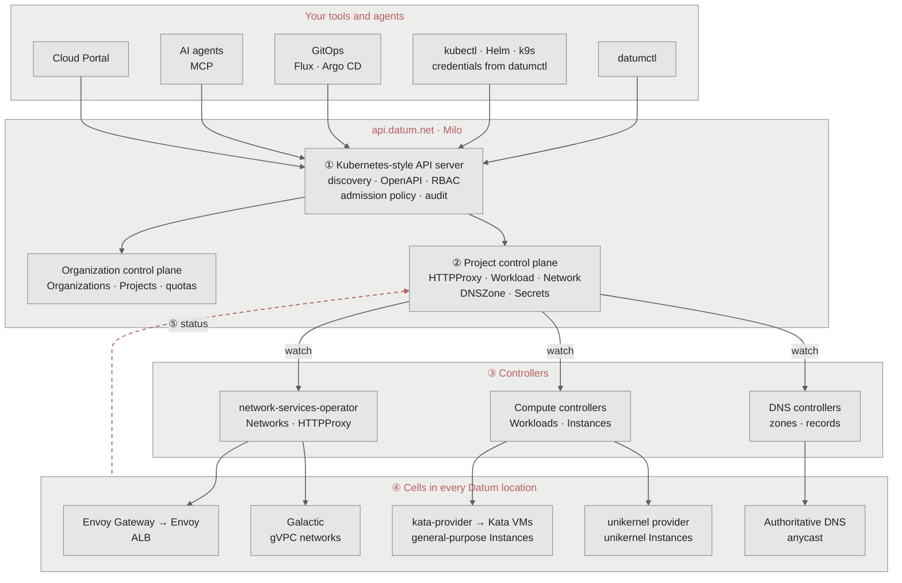

Datum's platform and its API are built on Kubernetes, and the resources you work with are native Kubernetes constructs. Not Kubernetes as a container scheduler, but the part that makes Kubernetes powerful: an API server where everything is a typed resource, and controllers that keep reality matching what those resources declare. You don't need to know Kubernetes to use Datum, but it helps to understand what's under the hood.

Everything you create on Datum, from a DNS zone to a load balancer to a Compute workload, is a Kubernetes-style resource served by the Platform API. Controllers pick each one up and make it real in Datum's locations.



1. **One API.** Every tool talks to the same Kubernetes API server at `api.datum.net`. It handles discovery, schemas, authentication, authorization, admission policy and audit logging for every request.
2. **Your resources live in a project.** Organizations and projects each get their own control plane. Your `HTTPProxy`, `Workload`, `Network` and `DNSZone` resources live in your project's control plane, isolated from every other project.
3. **Controllers watch your resources.** Each product has controllers that watch for changes to its resources, such as the [network services operator](https://github.com/datum-cloud/network-services-operator) for networks and load balancers.
4. **Controllers make it real in every location.** Controllers reconcile your resources into the clusters that run Datum's data plane in each location. That's where Envoy, Galactic, DNS servers and your Compute Instances actually run.
5. **Status flows back.** What happened in each location is written back to your resource's status, which is what `datumctl get` and the [Cloud Portal](https://cloud.datum.net) show you.

## Datum's control plane: Milo

Datum's control plane is [Milo](https://github.com/datum-cloud/milo), an open source, multi-tenant control plane for service providers. Milo uses the Kubernetes API server as a generic control plane, without the container-scheduling parts it doesn't need. It keeps what matters for a platform:

- **API discovery and schemas,** through the Discovery API and OpenAPI v3, so clients learn what exists and how to use it.
- **Declarative validation and policy,** with admission policies written in CEL.
- **Authentication and authorization,** with OIDC and role-based access control.
- **Audit logs** of who did what and when. See [Activity logs](/operations/activity-logs).
- **Event-driven reconciliation,** through watches and controllers, instead of polling and scripts.
- **Extensibility,** with custom resource definitions (CRDs) for most types and aggregated API servers where a type needs custom behavior.

Organizations, projects and quotas are resources too. Your organization has its own control plane for organization-wide resources, and each project has a control plane for the resources you build with.

## How your tools reach it

Because the API follows Kubernetes conventions, many tools can use it, and they all see the same resources:

- **[datumctl](/datumctl/overview)** is Datum's CLI. Commands such as `datumctl get`, `apply`, `diff`, `explain` and `api-resources` are Kubernetes verbs, sent to your organization's or project's control plane.
- **[kubectl, Helm and k9s](/datumctl/kubectl-interop)** work against the same control planes. `datumctl auth update-kubeconfig` writes a kubeconfig entry that gets its credentials from your `datumctl` session.
- **[GitOps tools](/datumctl/gitops)** such as Flux and Argo CD apply your resources from Git, the same way they would to a Kubernetes cluster.
- **AI agents** use the [Datum MCP server](/agents/datum-mcp) or `datumctl`. Well-known Kubernetes patterns make it easier for models to work with Datum accurately.
- **The Cloud Portal** reads and writes the same resources.

Under the hood, a project's resources live under a path like the following, which [`datumctl api-proxy`](/datumctl/api-proxy) exposes on your machine:

```text
https://api.datum.net/apis/resourcemanager.miloapis.com/v1alpha1/projects/PROJECT_ID/control-plane/apis/networking.datumapis.com/v1alpha/...
```

To see every resource type your project offers, run `datumctl api-resources`. To read the schema of one, run `datumctl explain`. For more information, see [Discovering resources](/datumctl/discovering-resources).

## Controllers turn resources into infrastructure

Each product is a set of resources plus the controllers that reconcile them. Controllers watch your project's control plane, and act in the clusters that run each Datum location:

| You create | Controllers | What runs in each location |
| --- | --- | --- |
| `HTTPProxy`, `TrafficProtectionPolicy` | [network services operator](https://github.com/datum-cloud/network-services-operator) and [Envoy Gateway](https://gateway.envoyproxy.io/) | [Envoy](/platform/envoy), as your [ALB](/alb/overview) |
| `Network` | network services operator and [Galactic](/platform/galactic) | Your [gVPC](/galactic-vpc/overview) network |
| `Workload` with the `general-purpose` runtime class | Compute controllers and [kata-provider](https://github.com/datum-labs/kata-provider) | Each Instance as a container in its own virtual machine, with [Kata Containers](https://katacontainers.io) |
| `Workload` with the `unikernel` runtime class | Compute controllers and the [unikernel](/compute/runtimes/unikernels) provider | Each Instance as a unikernel |
| `DNSZone`, `DNSRecordSet` | DNS controllers | Records on Datum's anycast [authoritative DNS](/domain-dns/dns) |

Each runtime class has its own provider, released and operated separately, so a fault in one class can't take down the other. For example, kata-provider only acts on Instances of the `general-purpose` class. It runs each one as a Kubernetes Pod in a Kata virtual machine, so every Instance gets its own kernel. See [Runtimes](/compute/runtimes/overview).

## Why Kubernetes-native

We took a bet on building the platform and its API on Kubernetes for the following main reasons.

### Ecosystem

It's aligned with the largest ecosystem for cloud operators. If you're a cloud native SRE or platform engineer, working with Datum capabilities exposed as resources should feel familiar, and the tools you already use, such as kubectl, Helm, k9s, Flux and Argo CD, already speak it.

### LLMs

Because Kubernetes patterns are so well established, LLMs work with Datum more accurately.

### Semi-free lunch

By modeling our platform on Kubernetes-style APIs, we get a lot of battle-hardened machinery at modest cost: discovery, validation, access control, audit, watches and garbage collection. It isn't completely free. A provider-grade control plane still has to handle multi-tenancy, storage limits and search, and Datum builds dedicated services where the core API shouldn't stretch.

<Note>
  For more information, see [Building a distributed control plane for modern service providers](https://www.datum.net/blog/control-plane-for-modern-service-providers/) by Scot Schuchert-Wells, and [From cage nuts to Kubernetes](https://www.datum.net/blog/from-cage-nuts-to-kubernetes/) by Tom Daly.
</Note>
