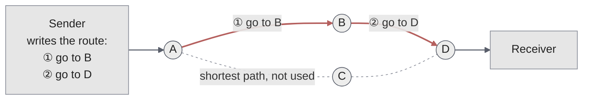
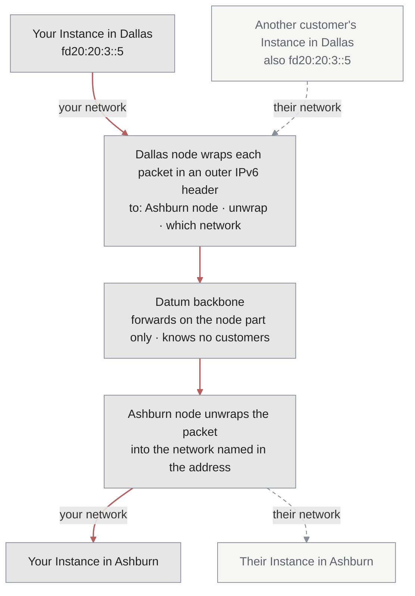
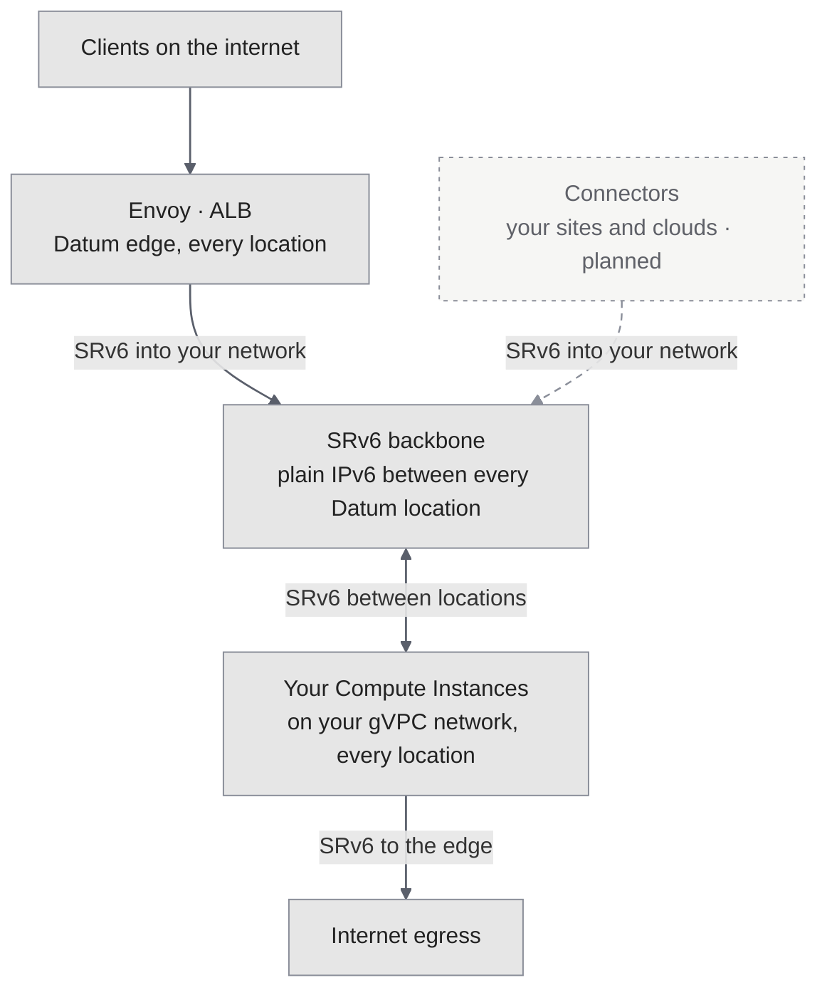
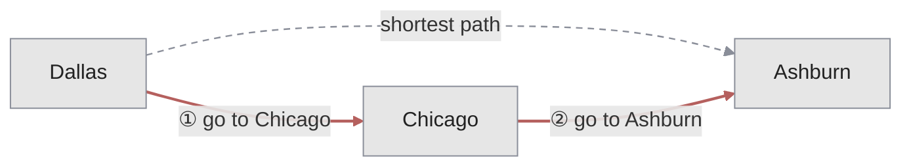

Datum's backbone uses IPv6 segment routing (SRv6) to carry traffic between locations. Segment routing is usually something only network engineers talk about, but the idea behind it is simple, and once it clicks, a lot of what Datum does makes sense. This page starts with one packet and builds up from there.

You don't need to know any of this to use Datum. It explains what happens underneath [gVPC](/galactic-vpc/overview), the [Application Load Balancer](/alb/overview), and the rest of the platform.

## Start simple: the packet carries its route

In most networks, every router makes its own decision. A packet arrives, the router looks up the destination address, and it sends the packet one hop closer. The packet has no say in how it gets there. To make some traffic take a different path, or to keep one customer's traffic apart from another's, every router along the way has to be told about it and has to remember it.

Segment routing flips this around. The sender writes the route into the packet, as an ordered list of instructions called *segments*. Each router reads the current instruction, called the *active segment*, carries it out, and moves on to the next one. The routers in the middle don't need to know anything about the traffic. They just follow the instructions.

In this example, the shortest path from A to D goes through C. But the sender wants the packet to go through B, so it writes two segments: "go to B", then "go to D". A sends the packet toward B. When it arrives, B sees that its segment is done and moves to the next one, "go to D". None of the routers had to be configured for this one packet.

A segment can say several kinds of things:

- **Go to a node.** Reach this router by the shortest path. This is a *node segment*.
- **Use a link.** Leave through this specific link, even if it isn't the shortest way. This is an *adjacency segment*.
- **Do something.** When you get here, carry out a function, such as delivering the packet into a particular private network.

Because the route lives in the packet, the network in the middle stays simple. It doesn't hold state for each customer, each connection, or each special path. That's what lets segment routing scale.

## SRv6: segments are IPv6 addresses

There are two ways to write segments into a packet. The older way uses MPLS labels. SRv6, which Datum uses, writes each segment as an IPv6 address. That has a big advantage: any router that can forward IPv6 can carry SRv6 traffic, because to most of the network an SRv6 packet is just an IPv6 packet.

An SRv6 address isn't only a destination. Its bits are split into parts that tell the network where the packet goes and what to do when it gets there:

<Frame caption="The 128-bit layout of the SRv6 addresses Datum uses">
  
</Frame>

- **Block and Node-ID** say which node the packet goes to. Datum's backbone routes on this 64-bit prefix only.
- **Function** says what that node does with the packet, such as unwrap it and deliver it into a private network.
- **Argument** says which private network on that node receives it.

Datum uses a compact form of SRv6 called *micro-segments* (uSID), which packs instructions tightly into each address.

## Expand the scope: private networks on a shared backbone

Now put this to work. Two customers each run an Instance in Dallas and another in Ashburn, on their own [gVPC](/galactic-vpc/overview) networks. They happen to use exactly the same private addresses. How does Datum keep their traffic apart on shared infrastructure?

1. When your Instance in Dallas sends a packet to your Instance in Ashburn, the Dallas node wraps it in an outer IPv6 header. The outer destination is an SRv6 address that means "the Ashburn node, unwrap this, into *your* network".
2. Datum's backbone forwards the packet on the node part of that address, like any other IPv6 packet. The routers in between never see your private addresses and don't know you exist.
3. The Ashburn node reads the function and argument, unwraps the packet, and delivers it inside your network only.

The other customer's packets travel the same way, with a different network in the address. Even though both customers use the same private addresses, and even though their traffic shares the same nodes and links, a packet can only ever be delivered into the network its address names. Isolation comes from the routing itself, enforced in each node's kernel, not from firewall rules that someone has to keep correct.

This is also why networks on Datum cost nothing to plan. Adding a network doesn't add state to the backbone. It's one more value that an address can carry. For more on how Galactic builds these networks, see [Galactic](/platform/galactic).

## Expand again: one backbone for the whole platform

The same mechanism carries more than traffic between Instances. Anything that needs to reach your private network uses it:

- **Load balancers.** Envoy, the proxy behind every [ALB](/alb/overview), reaches your Instances by wrapping its connection in an SRv6 address for your network. One shared fleet of proxies serves every customer without ever reaching the wrong network. See [Envoy](/platform/envoy).
- **Compute Instances.** Instances reach each other across locations over the same backbone, with no VPNs or peering to set up. See [gVPC traffic](/galactic-vpc/networks/traffic).
- **[Connectors](/connectors/overview) and internet egress.** Outbound traffic to the internet already joins your network this way. Connections from your own sites and clouds are planned to follow. See [gVPC planned capabilities](/galactic-vpc/limitations-and-roadmap#planned-capabilities).

Because every product speaks SRv6, adding a new way to connect to your network doesn't need a new network. It needs a new place that can write the right address.

## Where it's going: choosing the path

So far, packets have followed the shortest path between nodes. But the shortest path isn't always the fastest. Segment routing can steer traffic along a different path by adding segments, just like the first example on this page.

Datum is working on latency-aware routing for gVPC. The platform would continuously measure delay between nodes, and steer traffic onto the path that's actually fastest rather than the one with the fewest hops. You would be able to express intent, such as "prefer low latency", for your workloads, and see the results in metrics.

<Note>
  This section describes where Datum is headed. Plans can change, and this isn't a commitment to deliver any feature or to meet any timeline.
</Note>

## Learn more

- [Segment Routing introduction](https://www.segment-routing.net/tutorials/2016-09-27-segment-routing-introduction/), from segment-routing.net.
- [Introduction to Segment Routing](https://packetpushers.net/blog/introduction-to-segment-routing/), from Packet Pushers.
- [Meet me in the Galactic VPC](https://www.datum.net/blog/galactic-vpc-backbone/), on why Datum built Galactic on SRv6, from the Datum blog.
- [RFC 8402: Segment Routing Architecture](https://www.rfc-editor.org/rfc/rfc8402) and [RFC 8986: SRv6 Network Programming](https://www.rfc-editor.org/rfc/rfc8986), the standards behind it.

## Related

- [Galactic](/platform/galactic) — the open source network software that builds Datum's private networks on SRv6.
- [gVPC](/galactic-vpc/overview) — private IPv6 networks for your workloads.
- [Envoy](/platform/envoy) — how load balancers reach your private network.
